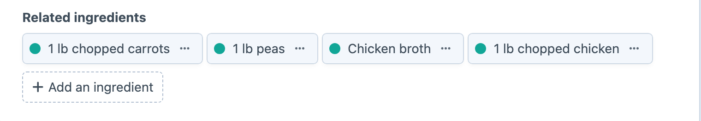
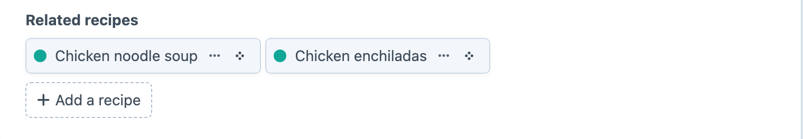

# Usage

Suppose your site has Recipes and Ingredients sections, with handles `recipes` and `ingredients`. You want editors to select ingredients on a recipe and also manage that relationship from an ingredient. Many to Many exposes the other side of the same Craft relation.

## Set Up the Relationship

Create an Entries field called Related Ingredients (`relatedIngredients`) that selects entries from Ingredients, and add it to the Recipes entry layout. This field owns the underlying Craft relation.

Next, create a Many to Many field called Related Recipes (`relatedRecipes`) and configure it with these settings:

- **Linked Section** — choose Recipes, the section containing the entries that own the Related Ingredients field.
- **Associated Field** — choose Related Ingredients, the Entries field that stores the relation.

Add Related Recipes to the Ingredients entry layout. The completed relationship lets editors choose ingredients from a recipe or recipes from an ingredient while keeping the same underlying relation in sync.





Open a recipe, select an ingredient and save it. Open that ingredient and check the reverse field for the recipe. Change the selection there, save, and reopen the recipe to confirm the relationship changed from both sides.

## Access Related Entries in Twig

The Many to Many field returns the related entries directly. Put this example in an ingredient entry template, where `entry` is the current ingredient:

```twig
<h1>Related Recipes</h1>

<ul>
    
        <li><a href="{{ recipe.url }}">{{ recipe.title }}</a></li>
    
        <li>No recipes use this ingredient.</li>
    
</ul>
```

When listing several ingredients, eager-load the field so Craft can fetch their related recipes together rather than running another query for each ingredient:

```twig



    <h2>{{ ingredient.title }}</h2>

    <ul>
        
            <li>{{ recipe.title }}</li>
        
            <li>No related recipes.</li>
        
    </ul>

```

Because the relationship uses Craft's native relations, `relatedTo()` queries remain available. For example, this query finds recipes related to the current ingredient without referring to the reverse field handle:

```twig

```

## Filter by Whether a Relation Exists

The field supports Craft's `:empty:` and `:notempty:` conditions. This example finds ingredients used by at least one live recipe:

```twig

```

Use `relatedRecipes(':empty:')` to find ingredients without a live related recipe. Other values aren't supported as field-query conditions; use Craft's `relatedTo()` parameter when you need to filter by a particular entry.

## Query the Field with GraphQL

Add the Ingredients section, its entry type and the Related Recipes field to the GraphQL schema used by your request. You can then select the reverse field like another entry relation:

```graphql
query Ingredients {
  entries(section: "ingredients") {
    ... on ingredients_default_Entry {
      title
      relatedRecipes {
        title
        url
      }
    }
  }
}
```

Craft generates GraphQL type names from your section and entry-type handles. Replace `ingredients_default_Entry` if your Ingredients entry type has a different generated name. The relation field also accepts Craft's standard entry arguments when you need to limit or filter its results.

## Understand Saving, Drafts and Revisions

Changing a Many to Many field adds or removes the current entry from the associated Entries field on each affected linked entry. The editor must be allowed to view and save every linked entry that would be modified. If any selected entry is outside the configured section, lacks the associated field or can't be saved by the editor, the save is rejected rather than partially updating the relationship.

Changes made in a draft stay with that draft and don't affect canonical entries until the draft is applied. Each user and draft keeps its own pending selection. Reverting an entry to an earlier revision doesn't restore these reverse relationships, because Craft stores the actual relation on the linked entries rather than on the entry being reverted.

## Field Constraints

Many to Many currently works with entries and one linked section at a time. The field itself must be placed on an entry layout, and its Associated Field must be a non-translatable Entries field. The Associated Field should be present on every linked entry type editors can select; configuration and save validation prevent unsupported combinations from changing content.
